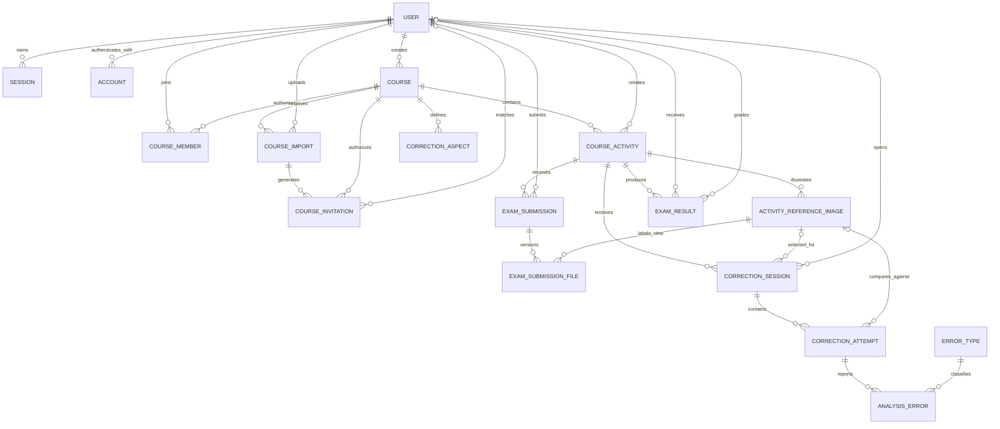

# Database architecture

This document describes the PostgreSQL database used by the teaching-support portal, its main relationships, the authorization model built on top of it, and the current limitations.

The database definitions currently have two sources:

- `drizzle/0000_initial_schema.sql`: the complete SQL baseline for a new database.
- `drizzle/0002_*.sql` through `drizzle/0004_*.sql`: incremental migrations for existing databases, including correction topics, derived session status, and exam submissions.
- `src/lib/server/db/schema.js`: the Drizzle ORM mapping used by the implemented APIs. It currently maps authentication, courses, memberships, imports, invitations, activities, correction sessions, correction records, and exam results. Some tables from the full baseline are not mapped yet.

## High-level relationship diagram

## Roles and authorization

There are two related but different role systems.

### Application role

`user.role` describes a user's global role:

| Role | Meaning |
| --- | --- |
| `developer` | Global administrator with access to every course. |
| `professor` | May create courses and manage courses where they have an active professor membership. |
| `student` | May access courses where they have an active membership. |

### Course role and status

`course_member.role` and `course_member.status` describe authorization inside one course:

| Field | Values | Meaning |
| --- | --- | --- |
| `role` | `PROFESSOR`, `STUDENT` | Course-specific responsibility. |
| `status` | `ACTIVE`, `SUSPENDED`, `REMOVED` | Only `ACTIVE` memberships grant access. |

A global `professor` does not automatically manage every course. The user also needs an `ACTIVE` `PROFESSOR` membership for that course. Developers are the exception and can manage all courses.

When a course is inserted, the `course_creator_membership_trigger` automatically creates an active professor membership for its creator. `course.created_by_user_id` is therefore historical ownership, while current management permission comes from `course_member`.

Authorization is enforced by the service layer using `locals.user`. The database itself does not currently use PostgreSQL row-level security.

## Authentication tables

### `user`

Stores the Better Auth user and the global application role. Email uniqueness is case-insensitive in the baseline SQL through an index on `lower(email)`.

Important relationships:

- Owns authentication sessions and provider/password accounts.
- Creates courses and activities.
- Participates in courses through `course_member`.
- Uploads course imports and sends invitations.
- Opens correction sessions, which own their correction records.

### `session`

Stores Better Auth sessions. Deleting a user deletes their sessions. `impersonatedBy` is optional and becomes `NULL` if the impersonating user is deleted.

### `account`

Stores password or external-provider credentials. The pair `(providerId, accountId)` is unique in the baseline database.

### `verification`

Stores temporary verification values, such as email-verification and password-reset tokens.

## Course authorization tables

### `course`

Represents a course. It contains a name, description, optional start/end dates, an active flag, and its historical creator.

Rules:

- Only a global professor or developer can create a course through the API.
- An authorized member can read an active course.
- An active course professor can manage their course.
- A developer can manage every course.
- The end date must be later than the start date when both are provided.

Deleting a course cascades to its memberships, imports, invitations, activities, correction aspects, and their dependent records.

### `course_member`

Connects one user to one course. The `(course_id, user_id)` pair is unique.

A membership can be created in either of these ways:

1. A course professor or developer explicitly authorizes the user.
2. A user with a verified email accepts a valid, unexpired invitation matching that email.

Only an `ACTIVE` membership grants course access. Professors and developers can assign, suspend, reactivate, change, or remove memberships through the service layer.

### `course_import`

Records an import operation and its result counters. It stores the source filename, an optional storage key, totals, rejected-row details, and the uploading user.

Only a professor or developer can import members. A professor must also manage the target course.

### `course_invitation`

Acts as an email allow-list for a course. An invitation may originate from an import and may later be matched to a registered user.

Database constraints require a Politecnico di Torino address under `polito.it`, and each email can appear only once per course, case-insensitively. A matching user's email must be verified before self-enrolment creates an active membership.

## Activities

### `course_activity`

An activity belongs to one course and is created by one user. Its kind is `LESSON` or `EXAM`; its lifecycle status is `DRAFT`, `PUBLISHED`, or `ARCHIVED`.

Members can access an activity only when all the following are true:

- Their course membership is active.
- The course is active.
- The activity status is `PUBLISHED`.
- The current time is at or after `available_from`, when defined.
- For lessons, the current time is at or before `available_until`, when defined. Exams remain readable after the deadline so students can review their locked submission and, later, their published result.

Course professors and developers can manage activities outside the publication and availability window.

The database also ensures that duration and correction limits are positive, that the availability interval is valid, and that `results_released_at` is used only for exams.

### `activity_reference_image`

Stores reference images associated with an activity. It records the storage key, filename, MIME type, view type, alternative text, and display order.

When the view type is `OTHER`, `custom_view_label` is required. For predefined view types, the custom label must be `NULL`.

No CRUD API or Drizzle mapping has been implemented for this table yet.

## Correction workflow

### `correction_aspect`

Defines course-specific correction categories such as camera, lighting, or texture. The category code is unique within a course.

No CRUD API or Drizzle mapping has been implemented for this table yet.

### `correction_session`

Represents a member's correction conversation for one activity. A session does not persist a separate lifecycle status. API and professor-view statuses are derived from the latest non-cancelled attempt: no attempt is `OPEN`, queued or processing is `PROCESSING`, completed is `ANSWERED`, and failed or unavailable is `FAILED`.

**Every new correction session must select one reference image belonging to the same activity and one analysis focus.** Analysis focuses are stored with the stable IDs **`LIGHT`, `CAMERA`, `MATERIAL`, `TEXTURE`, and `GENERAL`**; localized display labels are resolved only in the UI. Materials and textures are evaluated as separate categories.

**The selected reference image (`reference_image_id`) and analysis focus (`analysis_focus`) are fixed when the session is created.** This keeps the point of view and evaluation criterion consistent throughout a conversation. If the selected reference image is deleted, the database sets `reference_image_id` to `NULL`.

An authorized course member can create a session only while the activity is available. The session owner and course staff can access it. Other course members cannot access it.

For an anonymous session, an alias is required. The database still stores `student_user_id`; anonymity is a presentation and authorization feature, not database anonymization. Professor-facing API responses remove the student ID for anonymous sessions.

### `correction_attempt`

Represents one submitted image and its complete analysis lifecycle. It stores a per-session sequence number, image name, analysis focus, reference view and image, worker job ID and status, cancellation time, provider/model metadata, prompt version, summary, raw response, failure reason, score, and processing timestamps. **LLM analysis scores are constrained to the range 0–30.** Attempt numbers are generated by the service, are unique within a session, and must be positive.

There is no direct user foreign key because ownership and access come from the parent `correction_session`. The session owner and course staff can manage attempts while the session is accessible; after the latest non-cancelled attempt fails, a new conversation is required. The LLM score remains distinct from an official exam result.

## Analysis and results

### `exam_submission` and `exam_submission_file`

Each student has at most one submission record per exam. Its files are versioned per configured reference view: uploading a replacement marks the previous file as historical and inserts a new revision, while removal also preserves the old row. A partial unique index guarantees that only one current file exists for each submission and view.

Students may add, replace, or remove their own current files only while the published exam is inside its submission window. After `available_until`, the API is read-only. Course managers can inspect every student's current files and revision history. Exam activities require a submission deadline and use this workflow instead of correction sessions.

### `error_type`

Defines global or course-specific error categories. Codes are unique in their applicable scope.

### `analysis_error`

Stores individual errors detected for a correction attempt, including severity, confidence, description, suggestion, and optional coordinates. Each error references `correction_attempt` directly. Confidence is constrained to the range 0–1.

### `exam_result`

Stores one official result per student and exam activity. It supports `DRAFT`, `READY`, and `PUBLISHED` states. **Exam scores are constrained to 0–30**, and a published result must have `published_at` set.

Exam results are exposed through `/api/risultati` and `/api/risultati/[id]`. Developers and active professor managers may create, read, update, and delete results for exams in courses they manage. Students may only read their own `PUBLISHED` result after both `published_at` and the activity's optional `results_released_at` have been reached. These publication fields apply only to exam results: the service and database reject result creation or grading unless the activity is currently an `EXAM`.

The database enforces the grading scope with `exam_result_scope_constraint`: the activity must be an exam, the result owner must be an active student member, and `graded_by_user_id` must identify either a developer or an active professor manager of the activity's course.

## Database views

### `professor_correction_overview`

Provides a professor-facing correction-session projection. It hides student names and emails for anonymous sessions. The application must still restrict rows to courses managed by the requesting professor.

### `activity_error_statistics`

Aggregates completed analysis errors by activity and error type, including occurrence counts and average attempt scores.

## Delete behavior

The most important foreign-key actions are:

| Deleted record | Result |
| --- | --- |
| User | Sessions, accounts, memberships, and some other dependent records are deleted. Optional references may become `NULL`. Correction records are owned through their parent session rather than directly by a user. |
| Course creator or activity creator | Deletion is restricted while the created record exists. |
| Course | Course-owned records and their descendants are deleted through cascades. |
| Course import | Invitation `import_id` values become `NULL`; invitations remain. |
| Activity | Reference images, correction sessions, exam results, and their descendants are deleted. |
| Correction session | Attempts and their detected errors are deleted. |
| Correction attempt | Its detected errors are deleted. |

These are hard deletes and are not recoverable through the application.

## Current API coverage

| Resource | Collection endpoint | Item endpoint | Operations |
| --- | --- | --- | --- |
| Users | `/api/utenti` | `/api/utenti/[id]` | List, create, read, update, delete |
| Courses | `/api/corsi` | `/api/corsi/[id]` | List, create, read, update, delete |
| Member import | `/api/corsi/import` | — | Import/authorize email list |
| Members | `/api/membri?courseId=...` | `/api/membri/[id]` | List, create, read, update, delete |
| Activities | `/api/esercitazioni?courseId=...` | `/api/esercitazioni/[id]` | List, create, read, update, delete |
| Correction sessions | `/api/sessioni-correzione?activityId=...` | `/api/sessioni-correzione/[id]` | List, create, read, update, delete |
| Correction attempts | `/api/tentativi-correzione?sessionId=...` | `/api/tentativi-correzione/[id]` | List, create, read, update, delete |
| Exam results | `/api/risultati?activityId=...` | `/api/risultati/[id]` | List, create, read, update, delete |

API responses use either `{ "data": ... }` or `{ "error": { "code": "...", "message": "..." } }`. Collection endpoints accept `page` and `pageSize` (default 25, maximum 100) and return `{ items, page, pageSize, total, totalPages }` inside `data`.

PostgreSQL uniqueness, foreign-key, exclusion, check/not-null, serialization, and deadlock failures are translated to stable `409` API errors. Database details and constraint names are not exposed to clients.

`max_corrections_per_student` is enforced across all attempts made by one student for an activity. Session and analysis-job creation reject an already exhausted quota, while attempt insertion performs the authoritative check under a transaction-level activity/student lock and returns `CORRECTION_LIMIT_REACHED` without allowing concurrent submissions to exceed the limit.

Tables with an `updated_at` or `updatedAt` column use PostgreSQL `BEFORE UPDATE` triggers, so timestamps remain correct for application and direct-database writes.

Correction sessions use an explicit state machine: `OPEN` may move to `PROCESSING`, `CLOSED`, or `FAILED`; `PROCESSING` may move to `ANSWERED`, `CLOSED`, or `FAILED`; `ANSWERED` may only move to `CLOSED`; and `CLOSED`/`FAILED` are terminal. Idempotent same-state updates are accepted, and conditional writes prevent concurrent requests from applying transitions validated against stale state.

## Known limitations

1. **Authorization is application-level.** There is no PostgreSQL row-level security. Direct database access can bypass the checks performed with `locals.user`.

2. **The Drizzle mapping is incomplete.** Correction aspects, analysis errors, and the database views exist in the baseline SQL but are not represented in `schema.js` and do not have services or APIs.

3. **Migration bookkeeping is manual.** The unified SQL baseline is not tracked by a Drizzle migration journal/snapshot. Running `drizzle-kit generate` without first establishing a baseline snapshot may generate a duplicate initial migration.

4. **Course dates are not access gates yet.** `course.starts_at` and `course.ends_at` are stored and validated, but member visibility currently depends on `is_active`, not on the course date interval. Activity date intervals are enforced.

5. **Imports accept JSON email arrays.** The API does not currently parse CSV/XLSX files or upload files to object storage. `original_filename` and `storage_key` are metadata only.

6. **Import counter naming is historical.** In the current service, `created_users` counts newly created invitation/authorization records, not newly created authentication accounts. Imports never generate passwords or user accounts.

7. **Invitation completion is request-driven.** A newly registered user must call the member-creation endpoint after verifying their matching email. There is no automatic post-verification job that consumes pending invitations.

8. **Anonymous sessions are pseudonymous, not anonymous at rest.** The real user ID remains in the database. Service responses redact it for professors, but privileged database access can reveal it.

9. **There is no soft-delete or audit history for the new CRUD resources.** Deletion is immediate, and updates overwrite the previous value. Course imports retain import-level errors but do not provide a general audit trail.

10. **No rate limiting or content moderation is implemented.** The APIs rely on authentication and authorization but do not limit repeated imports, session creation, or attempt creation.

11. **Some read-then-write workflows remain optimistic.** Database constraints and conflict translation keep failures consistent, but callers may still need to retry operations that race with another request.

12. **Deleting users has mixed consequences.** Creator foreign keys can prevent deletion, while correction-session ownership becomes `NULL`. Correction attempts remain attached to that session. A retention policy should be defined before production use.

## Recommended next steps

1. Record the unified baseline in Drizzle metadata and establish the migration workflow for future schema changes.
2. Decide whether course dates should also control member access.
3. Add services and APIs for analysis errors as that feature is activated.
4. Add an audit log or soft-delete policy for security-sensitive and grading data.

## Tests

Run `npm test` for the database-conflict response contract. Run `npm run test:integration` with `TEST_DATABASE_URL` pointing to a disposable PostgreSQL database whose name contains `test`. The integration setup resets that database's `public` schema, loads the complete baseline, and covers authenticated/unauthenticated role-resource access, activity availability boundaries, correction-session statuses derived from attempts, and a real unique-constraint conflict.
